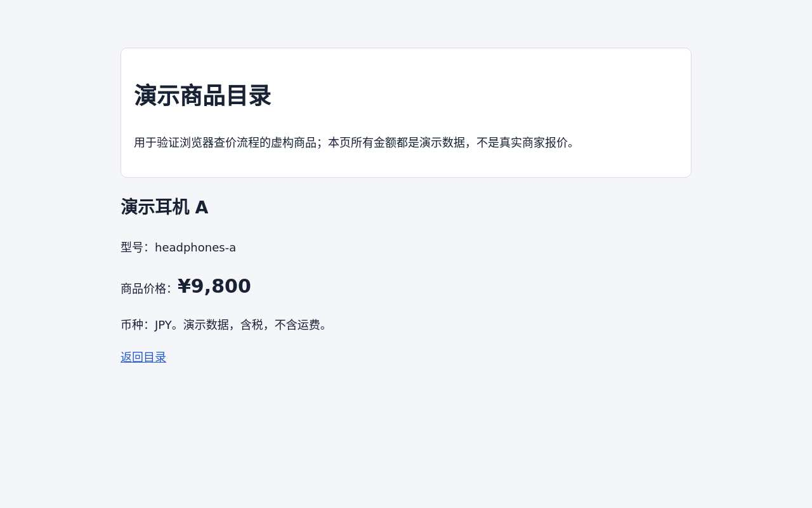

# Cloudflare price agent demo

A private, single-owner demo using **Cloudflare Agents SDK + Browser Run + DeepSeek Flash**. It is independent of the OpenMuse Docker computer and does not deploy E2B or Cloudflare Sandbox containers.

- Multiple saved conversations and follow-up questions, persisted in an Agent's SQLite storage.
- A browser reused across turns, navigation/search/input tools, Cloudflare Live View, and per-conversation browser checkpoints.
- Price cards retain the exact observed text, currency, source URL and observation time. Recording rejects a product name, amount or source absent from the latest page read. This is an evidence check, not a guarantee that two occurrences on a page refer to the same offer.
- Stop/close controls, a five-minute turn limit, a ten-step agent loop capped at sixteen tool actions, a two-minute browser idle timeout and a twenty-minute scheduled close. A later browser can restore the saved current page, cookies and current-origin web storage; chat history remains.
- A clearly labelled, fictitious product catalogue at `/demo-catalog` for reproducible browser tests. The UI also offers a real-web search prompt. CAPTCHA/login/access restrictions are reported rather than bypassed.

## Architecture and browser-only scope

Open [the architecture diagram](docs/architecture.html) as a standalone HTML file. It maps the deployed modules, the model/tool loop, the separate Live View connection, and alternative browser integrations.

The current deployment runs the Agents SDK and our model/tool loop in a Cloudflare Worker’s SQLite Durable Object. `@cloudflare/puppeteer` runs there as a controller; Chrome runs separately in Browser Run. DeepSeek receives messages and tool definitions over HTTPS and returns tool names/arguments. Our Durable Object executes those tools. The optional local Node proxy only forwards authenticated HTTP requests: it does not host the agent, call the model, or run browser tools. This example does not use the OpenMuse Docker computer SDK.

Only seven browser actions and `record_price` are exposed to the model. There are no filesystem, directory, shell, desktop-control or arbitrary JavaScript tools. Unknown tool names and invalid navigation URLs are rejected before launching a browser. Intercepted requests reject local/internal protocols; `data:` and `blob:` are retained only as page subresources. Agent interactions validate the current page and reject file inputs, explicit download links and links to non-web schemes. The policy is enforced by the dispatcher and URL checks in addition to the model instructions.

Reading a website’s visible text is part of browser use. Saving/restoring the browser’s cookies and current-origin web storage is internal session management, not a general file API. This restriction applies to the agent tools; authenticated Live View still provides manual interaction. Interception is not an OS filesystem sandbox or DNS pinning, and does not establish that every browser-originated download is blocked. No arbitrary local file or command endpoint is provided.

## Setup

Node.js 22 or newer and a Cloudflare account with Workers, SQLite Durable Objects and Browser Run access are required. The model is an external DeepSeek API call; Workers AI is not used.

```sh
cd examples/cloudflare-price-agent
npm ci
npm run types
npm run check
npm test
npm run build
```

`wrangler types` generates ignored `worker-configuration.d.ts`. For local development, create ignored `.dev.vars` with `DEEPSEEK_API_KEY` and a random `DEMO_ACCESS_TOKEN` of at least 32 characters, then run `npm run dev`. Local Browser Run is not a substitute for verification on the deployed binding.

## Deploy and open

Select the intended account with Wrangler authentication and `CLOUDFLARE_ACCOUNT_ID`. Set secrets through the interactive prompts; do not place them in source or command arguments:

```sh
npx wrangler secret put DEEPSEEK_API_KEY
npx wrangler secret put DEMO_ACCESS_TOKEN
npm run deploy
```

Open the deployed `workers.dev` URL and enter the demo access token. The token is held in tab-scoped session storage; the model API key remains server-side. This capability grants access to the owner's entire demo, not separate tenant accounts. Changing it selects a new owner namespace. There is no public `/agents/*` routing.

Alternatively, keep the token out of the frontend using the loopback proxy. Create `~/.config/openmuse-cloudflare-demo/settings.json` outside Git, with file mode `0600`:

```json
{
  "url": "https://YOUR-WORKER.YOUR-SUBDOMAIN.workers.dev",
  "accessToken": "YOUR-RANDOM-DEMO-TOKEN-AT-LEAST-32-CHARACTERS"
}
```

Run `npm run local` and open `http://127.0.0.1:8791`. `OPENMUSE_CF_SETTINGS` can select another settings file. `OPENMUSE_CF_PORT` changes the local port. The proxy only accepts loopback Host/Origin values, forwards to the configured Worker and adds demo authorization server-side. It respects `https_proxy` for outbound access. It does not execute the model or host a local browser.

## Save, close and reconnect

The browser panel provides explicit controls:

| Control | Behavior |
| --- | --- |
| Save | Save the current URL, cookies (including HttpOnly), current-origin localStorage/sessionStorage and scroll position; keep the browser running. |
| Save and close | Persist first, then close the browser. A failed save keeps the browser open and preserves the previous checkpoint. |
| Restore / reconnect | Reconnect to the existing browser when it is still alive; otherwise create a new browser and restore this conversation's checkpoint. |
| Disconnect only | Detach the control connection and the embedded viewer. The browser can remain active and billable. This is not a close operation. |
| Close directly | Close without capturing new changes; retain the last saved checkpoint. |
| Delete checkpoint | Delete the stored browser credentials and page state after closing the browser; keep chat and price records. |

Successful agent page reads/actions automatically save a checkpoint. After manual Live View interaction, click **Save** or **Save and close** to capture the latest state. Selecting an old chat alone does not restart its browser. The UI displays the last save time and save failures.

Checkpoints are separate SQLite rows per conversation. Cookie and storage values never enter the synchronized Agent state, the model tool results or public API metadata. Checkpoints may contain website login credentials, remain private to the demo owner, and can be deleted from the UI. The 512 KiB UTF-8 limit rejects a new checkpoint before replacing the old one. Opaque partitioned cookies cause an explicit save failure.

Restoration covers one current page and its origin's web storage. It does not save other tabs, IndexedDB, cache, downloads, browser history or JavaScript memory. A restored page runs again and websites may expire/revoke sessions or ask for login. This is a Browser Run checkpoint, not a Linux sandbox snapshot. A session that has already disappeared without a checkpoint cannot be recovered retroactively.

The explicit live smoke check creates fictional test sessions, exercises the deployed browser and model, and closes its browser on exit. It incurs provider usage and is not run in CI. Start the local proxy first:

```sh
npm run test:cloud
```

It uses `/api/health` to find the public fixture URL, verifies same-session reconnect and restoration into a new browser, and checks isolation/deletion. Evidence and its remote-browser screenshot go into ignored `.wrangler/` files. Set `OPENMUSE_DEMO_URL` and `DEMO_ACCESS_TOKEN` to target another private deployment.

## Boundaries

This is a private demo, not a multitenant service. Navigation rejects IP literals, local/internal hostnames, nonstandard ports and embedded credentials, including browser subrequests. This hostname policy is not DNS pinning or a replacement for Cloudflare's network isolation. No browser receives the DeepSeek key or the Cloudflare account token. Live View URLs are temporary bearer credentials: fetched only after authentication, never included in model messages, persisted or logged.

Live View embeds when the browser permits it; the same panel always provides a separate authenticated viewing link. Screenshots are captured after agent actions, not a substitute for the live stream. Opening a Live View can keep a browser active and billable; close it when finished. Actual target websites, billing/account limits, browser interruptions and price extraction must be verified on the deployed service. Placement is Cloudflare-managed and this demo does not guarantee Tokyo residency.

The root project's server/mobile/browser worker dependencies are unchanged. This example has its own npm lockfile and CI check; it does not deploy from CI.

## Checkpoint validation status

Twenty-two unit tests and fifteen local Miniflare HTTP checks passed. Browser lifecycle tests use a simulated protocol boundary and execute the serialized page callbacks in an isolated JavaScript context. They cover detaching without an implicit viewer reconnect, restoring cookies and both web stores into a fresh browser, expired sessions, recovery cleanup, failed/oversized saves, host-only cookies and conversation isolation. They are not real Chrome acceptance.

The deployed Cloudflare attempt is **blocked**: creating a browser returned HTTP 429, `Rate limit exceeded`, before a checkpoint could be created. The limits endpoint reported zero active sessions, maximum concurrency four, and one allowed acquisition; the provider did not identify the exact restriction. Real cloud save/restore and full chat-interface visual acceptance remain unverified. Re-run `npm run test:cloud` after the Browser Run restriction clears. No billing-plan change was made.

## Browser-only validation (2026-10-20)

The browser-only revision passed TypeScript checking, all **28 unit tests**, a Worker deployment dry run, and root Biome checking of 189 files. The additional policy tests cover rejecting unknown tools and local navigation before browser creation, intercepted request protocols, refusing to inspect a manually changed local page, and rejecting file controls/download links/non-web links before clicking. These use the simulated browser adapter, not actual Chrome.

The revision is deployed. A real DeepSeek turn refused a request to list server files/read `file:///etc/passwd`, and the deployed Agent did not launch a browser. The next public demo-catalogue navigation was **blocked by Cloudflare HTTP 429** during browser creation. Real browser behavior under the new policy therefore remains unverified; no browser was left running by this check. This refusal check does not replace the dispatcher policy tests.

The standalone architecture HTML passed HTTP and interactive step/highlight checks. Neither that HTML nor the full chat UI received visual browser acceptance. The main OpenMuse server/mobile/container suites were not run for this independent example.

## Initial deployment verification

The following acceptance checks ran against the actual Cloudflare deployment on 2026-10-19, using `deepseek-flash`:

- A first turn remembered a JPY 10,000 budget without launching a browser. A second turn entered “耳机” into the demo catalogue search, clicked search, visited two detail pages, and recorded JPY 6,500 and JPY 9,800. A third turn reused the same browser session and correctly answered that JPY 200 remained. These are fictitious demonstration prices.
- Retrying the original request ID returned the saved answer with `replay: true`.
- A real-web turn invoked Bing search, received no useful search results, then read Cloudflare's official Browser Run pricing page and recorded two exact page quotations with source URLs. Search availability remains dependent on the search engine and network; the agent reported this limitation.
- An authenticated Live View request returned a temporary `live.browser.run` URL. Its frontend responded HTTP 200 with `frame-ancestors *`. This verifies URL issuance and embed headers; interactive streaming and the complete chat UI have not received a manual browser acceptance pass.
- Stopping an active cloud turn after its browser launched returned a cancelled turn and left both the running task and browser state empty. Explicit browser close also retained the conversation's two recorded prices.
- Eleven core tests, TypeScript checks, a deployment dry run and thirteen local HTTP checks passed. The local HTTP checks covered authentication, SQLite conversation persistence and malformed/cross-origin requests. The main OpenMuse application test suite was not run for this isolated example.



The screenshot above is from the actual remote browser, not a screenshot of the chat interface. No account identifiers, access credentials or signed Live View URLs are included in this example.
